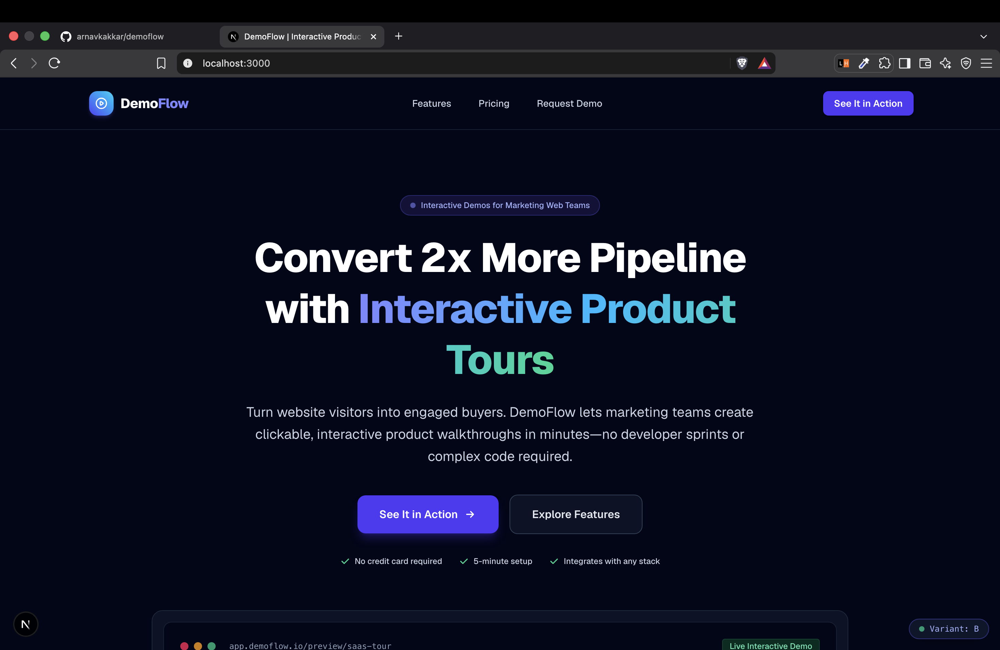
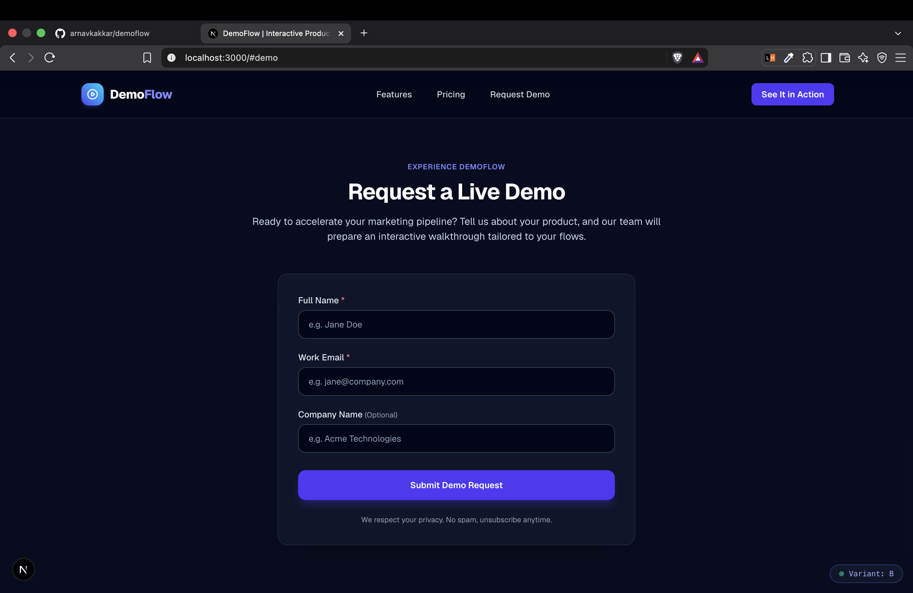
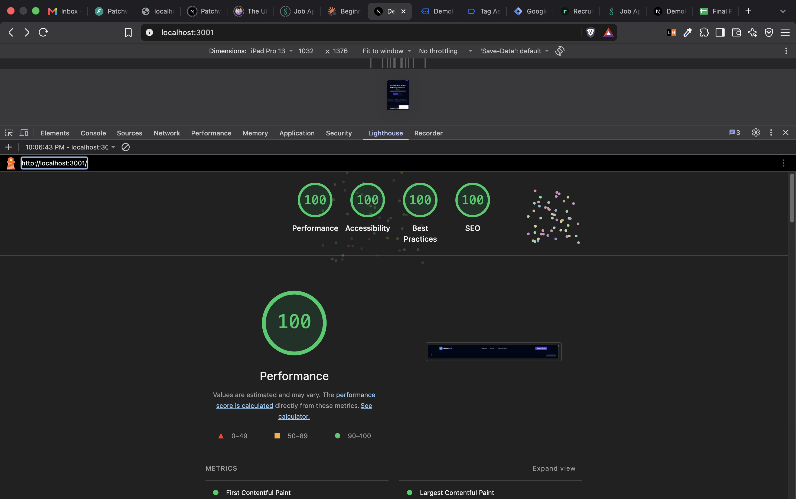

# DemoFlow Frontend

DemoFlow is an interactive product demo SaaS landing page built with modern web standards, featuring client-side A/B testing and dual telemetry tracking. It enables marketing and growth teams to showcase interactive product tours that drive conversions and pipeline growth.

> **Disclaimer**: DemoFlow is a fictional demonstration product created for testing and educational purposes. **Please do not enter real personal or sensitive information in the demo request form.**

---

## Screenshots

### Landing Page & Hero Section


### Demo Request Form


### Performance & Lighthouse Scores


---

## Tech Stack

- **Framework**: [Next.js 16](https://nextjs.org/) (App Router)
- **UI Library**: [React 19](https://react.dev/)
- **Styling**: [Tailwind CSS v4](https://tailwindcss.com/)
- **Language**: JavaScript (ES6+)
- **Analytics & Tag Management**: [Google Tag Manager](https://tagmanager.google.com/) (`next/script`, `window.dataLayer`)
- **Backend Communication**: Fetch API connecting to Flask REST endpoints

---

## Getting Started

### Prerequisites

- Node.js 18.x or later
- npm (or yarn / pnpm)

### Running Locally

1. **Install dependencies**:
   ```bash
   npm install
   ```

2. **Configure environment variables**:
   Copy the example environment file to create your local environment:
   ```bash
   cp .env.example .env.local
   ```
   Optionally update `NEXT_PUBLIC_GTM_ID` in `.env.local` with your Google Tag Manager Container ID (e.g., `GTM-XXXXXXX`).

3. **Start the development server**:
   ```bash
   npm run dev
   ```

4. Open [http://localhost:3000](http://localhost:3000) in your browser to view the application.

---

## How the A/B Test and Tracking Work

DemoFlow features an end-to-end A/B testing mechanism paired with dual telemetry (direct Flask API telemetry and Google Tag Manager `dataLayer` events).

### 1. Cookie Variant Assignment
- When a visitor loads the landing page, `lib/variant.js` checks the browser's `demoflow_variant` cookie.
- If no cookie exists, a random 50/50 assignment assigns the visitor to either:
  - **Variant A (Control)**: Feature-focused headline ("Interactive Product Demos That Close Deals Faster") with "Request a Demo" call-to-action.
  - **Variant B (Challenger)**: Benefit-focused headline ("Convert 2x More Pipeline with Interactive Product Tours") with "See It in Action" call-to-action.
- The selection is stored in a cookie with a 30-day expiration (`SameSite=Lax`, `path=/`) so returning users consistently see the same variation.

### 2. sessionStorage De-duplication
- In `components/Hero.jsx`, a `sessionStorage` key (`demoflow_view_tracked`) is checked before dispatching view events.
- This prevents React Strict Mode double-invocations in development and repeated page reloads from artificially inflating impressions, ensuring exactly one exposure view event is logged per browser session.

### 3. Google Tag Manager dataLayer Events
All visitor interactions push standardized events to `window.dataLayer` for tag triggering:
- **`ab_variant_view`**: Triggered once per session upon initial landing page view:
  ```javascript
  {
    event: "ab_variant_view",
    variant: "A" // or "B"
  }
  ```
- **`cta_click`**: Triggered when a visitor clicks any primary call-to-action button (in the Navbar, Hero, or Pricing sections):
  ```javascript
  {
    event: "cta_click",
    variant: "A", // or "B"
    button_location: "hero_primary" // "navbar" | "hero_primary" | "hero_secondary" | "pricing_*"
  }
  ```
- **`form_submit`**: Triggered when a visitor successfully submits the demo request form:
  ```javascript
  {
    event: "form_submit",
    variant: "A" // or "B"
  }
  ```

---

## Backend Integration

The Flask backend API lives in a separate repository (**`demoflow-backend`**) and runs by default on `http://localhost:5001`.

The frontend communicates with the backend via two endpoints:
- `POST http://localhost:5001/event`: Logs `view` and `click` telemetry events to the backend SQLite database.
- `POST http://localhost:5001/lead`: Submits lead capture form details (`name`, `email`, `company`, `variant`) to create lead records.

> **Note**: Both `lib/track.js` and `components/LeadForm.jsx` default to `http://localhost:5001` if `NEXT_PUBLIC_API_URL` is not specified in the environment. Analytics errors fail silently to ensure user experience is never degraded if the backend is unreachable.
